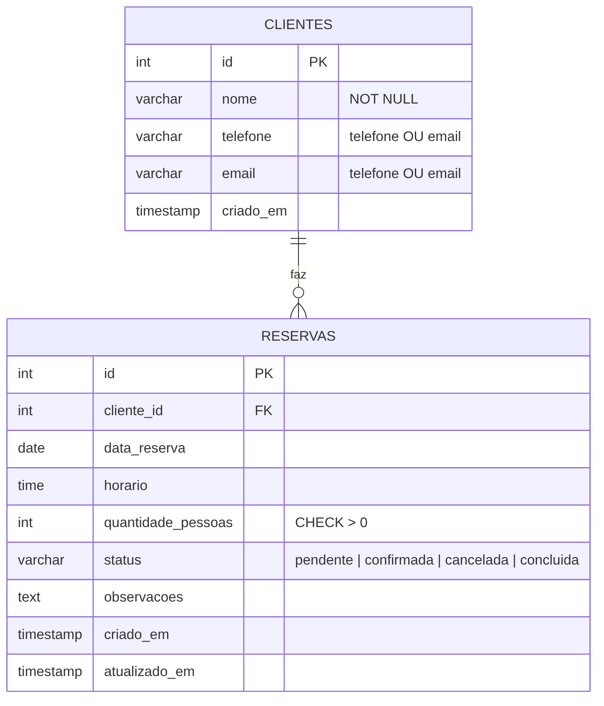

# Sistema de Reservas — Sabor & Cia (stack PERN)

Aplicação web para clientes solicitarem reservas e a equipe do restaurante consultar, pesquisar, editar e gerenciar o status delas.

- **PostgreSQL** — persistência (`database/database.sql`)
- **Express / Node.js** — API REST com validação e regras de negócio (`backend/`)
- **React + Vite** — interface (`frontend/`)

## Pré-requisitos

- Node.js 20+ e npm
- PostgreSQL 14+ rodando localmente

## Como executar

### 1. Banco de dados

```bash
createdb reservas_restaurante          # ou crie pelo pgAdmin/DBeaver
```

### 2. Backend

```bash
cd backend
cp .env.example .env                   # edite DB_PASSWORD e demais valores
npm install
npm run db:init                        # cria as tabelas e os dados de teste (apaga dados existentes!)
npm run dev                            # http://localhost:3333
```

Teste rápido: `GET http://localhost:3333/api/health`.

### 3. Frontend

```bash
cd frontend
cp .env.example .env                   # VITE_API_URL=http://localhost:3333
npm install
npm run dev                            # http://localhost:5173
```

### 4. Testes de integração (backend)

Os testes recriam as tabelas, por isso usam **outro banco**:

```bash
createdb reservas_restaurante_test
cd backend
npm test                               # usa o mesmo .env, trocando só o nome do banco
```

## Decisões do projeto

**Capacidade (estratégia simples, sem tabela de mesas).** O restaurante comporta no máximo **40 pessoas por data + horário**. Ao criar/editar uma reserva, a API soma as pessoas das reservas `pendente` e `confirmada` do mesmo dia e horário; se a soma mais a nova passar de 40, responde `409`. `cancelada` e `concluida` **não bloqueiam** a disponibilidade. Reativar uma reserva cancelada revalida a disponibilidade.

| Regra | Valor padrão (configurável no `.env`) |
|---|---|
| Horário de funcionamento | 11:00 às 22:00 (último horário de reserva) |
| Intervalo entre horários | 30 minutos |
| Máximo de pessoas por reserva | 12 |
| Capacidade por horário | 40 pessoas |
| Antecedência máxima | 90 dias |
| Fuso para "passado" | America/Sao_Paulo |

**Concorrência.** Criação, edição e reativação rodam em transação com `pg_advisory_xact_lock` por data: duas requisições simultâneas para o mesmo dia são serializadas e a segunda enxerga a primeira. Há um teste cobrindo isso (6 requisições simultâneas de 12 pessoas → exatamente 3 aceitas).

**Clientes.** A tabela `clientes` guarda os dados de contato. Se nome + telefone + e-mail forem idênticos a um cliente existente, ele é reaproveitado; caso contrário, um novo é criado (editar uma reserva nunca altera outras reservas do mesmo cliente).

**Edição.** Só reservas `pendente` ou `confirmada` podem ser editadas. Cancelar é preferido a excluir (o `DELETE` existe, mas a interface não o usa).

**Segurança.** Consultas 100% parametrizadas; credenciais só no `.env` do backend; erros internos do banco nunca vão ao navegador; validação na API e no React; limite de 50 kb no corpo das requisições. Não há login nesta versão (não faz parte do escopo inicial) — antes de publicar, proteja o painel com autenticação e use HTTPS.

## DER



Fonte editável: `docs/DER.mmd` (Mermaid). Relação: **CLIENTES 1:N RESERVAS**.

## Documentação da API

Base: `http://localhost:3333`. Respostas em JSON. Erros seguem o formato:

```json
{ "erro": "Dados inválidos.", "detalhes": [{ "campo": "nome", "mensagem": "Informe o nome do cliente." }] }
```

(`detalhes` aparece em erros de validação e de disponibilidade.)

Códigos: `200` ok · `201` criado · `204` sem conteúdo · `400` dados inválidos · `404` não encontrado · `409` conflito de disponibilidade / estado · `500` erro interno.

### Objeto reserva

```json
{
  "id": 1, "cliente_id": 1,
  "nome": "Ana Souza", "telefone": "(11) 98888-1111", "email": "ana.souza@email.com",
  "data_reserva": "2026-10-28", "horario": "19:00",
  "quantidade_pessoas": 4, "status": "confirmada",
  "observacoes": "Aniversário, levar bolo",
  "criado_em": "2026-10-27T20:00:00.000Z", "atualizado_em": "2026-10-27T20:00:00.000Z"
}
```

### `GET /api/health`
Verifica API e banco. `200 {"status":"ok","banco":"ok"}` ou `503`.

### `GET /api/configuracao`
Regras do restaurante usadas pelo frontend (horários, limites, status).

### `GET /api/reservas`
Lista ordenada por data e horário. Filtros opcionais (combináveis):

| Parâmetro | Exemplo | Descrição |
|---|---|---|
| `nome` | `?nome=ana` | contém o texto, sem diferenciar maiúsculas |
| `data` | `?data=2026-10-28` | `AAAA-MM-DD` |
| `status` | `?status=pendente` | `pendente`, `confirmada`, `cancelada`, `concluida` |

`200` array de reservas (vazio se nada corresponder) · `400` filtro inválido.

### `GET /api/reservas/:id`
`200` reserva · `400` id inválido · `404` não existe.

### `POST /api/reservas`
Corpo:

```json
{
  "nome": "Maria Lima",
  "telefone": "(11) 91234-5678",
  "email": "maria@email.com",
  "data_reserva": "2026-11-05",
  "horario": "20:00",
  "quantidade_pessoas": 4,
  "observacoes": "Mesa perto da janela"
}
```

`nome`, `data_reserva`, `horario`, `quantidade_pessoas` são obrigatórios; informe `telefone` **ou** `email` (ao menos um). `observacoes` é opcional.
`201` reserva criada (status `pendente`) · `400` validação (campo vazio, quantidade ≤ 0 ou > 12, data/horário passado, fora do funcionamento) · `409` sem disponibilidade.

### `PUT /api/reservas/:id`
Mesmo corpo do `POST` (substitui os dados). Revalida data, horário e disponibilidade (a própria reserva não conta como ocupando lugares).
`200` · `400` · `404` · `409` (sem disponibilidade, ou reserva cancelada/concluída).

### `PATCH /api/reservas/:id/status`
Corpo: `{ "status": "confirmada" }`. Reativar (de `cancelada`/`concluida` para `pendente`/`confirmada`) revalida disponibilidade.
`200` · `400` status inválido · `404` · `409`.

### `DELETE /api/reservas/:id`
Opcional. `204` · `404`.

### `GET /api/disponibilidade?data=2026-11-05&horario=20:00`
`200 {"data_reserva":"2026-11-05","horario":"20:00","capacidade":40,"ocupadas":16,"disponiveis":24}`

## Cenários de teste (guia, seção 12)

Todos automatizados em `backend/tests/reservas.api.test.js`:

| Cenário | Coberto por |
|---|---|
| Criar reserva válida e vê-la na listagem | `criar reserva › dados válidos` |
| Nome ou data vazios | `nome vazio...`, `data vazia...` |
| Quantidade zero/negativa | `quantidade zero, negativa...` |
| Data/horário no passado | `data e horário no passado...` |
| Horário indisponível (409, nada gravado) | `soma de pessoas...`, `requisições simultâneas...` |
| Pesquisar por data ou nome | `pesquisa e ordenação` |
| Editar reserva inexistente (404) | `reserva inexistente...` |
| Cancelar libera a vaga | `cancelar libera a vaga...` |
| API indisponível / recarregar a página | manual (veja abaixo) |

Testes manuais no navegador: pare o backend e recarregue (a tela mostra erro com "Tentar novamente"); recarregue com o backend ativo (dados vêm do banco).

## Estrutura

```
database/database.sql          tabelas + dados de teste + consultas de demonstração
docs/DER.png, DER.mmd          modelo de dados
backend/src/
  app.js, server.js
  config/      database.js (pool + transação), regras.js
  routes/      reservas.routes.js
  controllers/ reservas.controller.js     (HTTP <-> serviço)
  services/    reservas.service.js        (regras de negócio)
  repositories/ reservas.repository.js    (SQL)
  schemas/     reserva.schema.js          (validação)
  middlewares/ erros.js
backend/tests/ reservas.api.test.js
frontend/src/
  components/  ReservationForm, ReservationList, ReservationFilters, StatusBadge
  pages/       ReservationsPage.jsx
  services/    api.js, reservationsService.js
```
